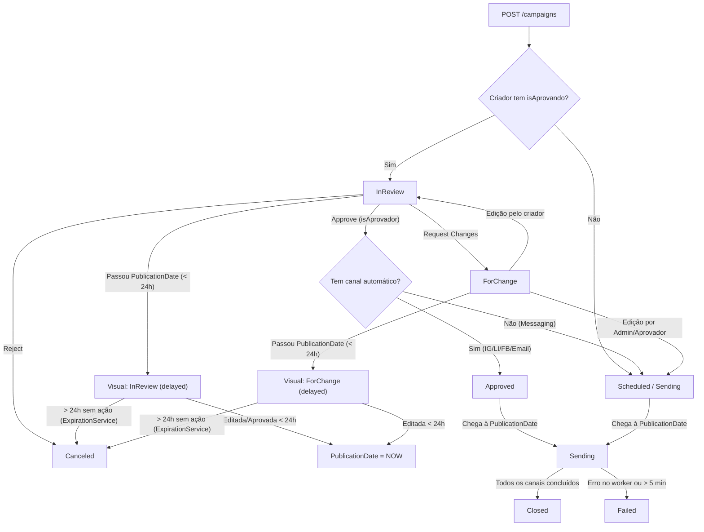

# Cockpit of Comms (CoC) — Documentação Completa do Projeto

Este documento descreve a arquitetura, o fluxo funcional, as integrações, os problemas já resolvidos ao longo do desenvolvimento, os problemas técnicos ainda em aberto (OOP, React, Segurança e Escalabilidade) e o guia para colocar a aplicação em produção com base de dados partilhada.

---

## 1. Visão Geral

O **Cockpit of Comms (CoC)** é uma aplicação web de gestão, aprovação e publicação automática de campanhas multicanal (**Email, Messaging, Instagram, Facebook e LinkedIn**).

| Camada | Tecnologia | Localização |
| :--- | :--- | :--- |
| **Back-end (API + Workers)** | .NET 10, ASP.NET Core Minimal APIs, EF Core, SQL Server, MailKit | `CoC_API/` |
| **Front-end (SPA)** | React, Vite, React Router | `CoC_front/` |
| **Testes Automatizados** | xUnit, `WebApplicationFactory`, SQLite in-memory | `CoC_API.Tests/` |

---

## 2. Estrutura do Projeto

### Back-end (`CoC_API/`)
- `Program.cs` — Configuração de DI, SQL Server (`CoC_DbContext`), autenticação por cookie, políticas de autorização, registo dos clientes HTTP/SMTP, dos 5 `BackgroundService` e seed opcional do Admin de desenvolvimento.
- `Models/`
  - `Campaign.cs` — Entidade de domínio rica com validações, normalização de `EmailRecipients` e transições de estado.
  - `User.cs` — Entidade de utilizador com características (roles/flags) e hashing de password.
  - `UserSession.cs` — Sessão persistida em BD (guarda apenas hash SHA-256 do token).
  - `Enums.cs` — `CampaignStatus`, `CampaignType`, `UserCaracteristics`, `Motivo`.
- `Context/CoC_DbContext.cs` — Mapeamento EF Core (`Users`, `Campaigns`, `UserSessions`).
- `Endpoints/`
  - `AuthEndpoints.cs` — `POST /login`, `GET /me`, `POST /logout`.
  - `UserEndpoints.cs` — CRUD e desativação de utilizadores (`/users`).
  - `CampaingEndPoints.cs` — Listagem, criação, edição, cancelamento e revisão/aprovação de campanhas (`/campaigns`).
- `DTOs/Request/` — Records imutáveis de entrada (`CreateCampaignRequest`, `EditCampaignRequest`, `CreateUserRequest`, `EditUserRequest`, `LoginRequest`, `MotivoRequest`, `RequestCampaignChangesRequest`).
- `Security/` — `UserSessionStore.cs` e `UserClaimsPrincipalFactory.cs`.
- `Integrations/` — Clientes e opções de publicação: `InstagramGraphApiClient`, `LinkedInApiClient`, `FacebookGraphApiClient`, `EmailClient` e respetivos `*PublishingOptions`.
- `Services/` — `BackgroundService` com polling de 15 em 15 segundos e estratégias de publicação:
  - `CampaignExpirationService.cs`
  - `CampaignPublishingService.cs` — Orquestrador único de publicação para todos os canais configurados.
  - `ICampaignChannelPublisher.cs` & `ChannelPublishers.cs` — Strategy Pattern para Instagram, LinkedIn, Facebook e Email.
- `Migrations/` — Histórico de migrações EF Core (`InitialCreate`, `AddLinkedInPostId`, `MultipleCampaignTypes`, `AddFacebookPostId`, `AddEmailMessageId`, `AddCampaignEmailRecipients`).

### Front-end (`CoC_front/src/`)
- `App.jsx` — Routing com `ProtectedRoute`, `PublicOnlyRoute` e `AdminRoute`.
- `models/` — `apiClient.js` (wrapper `fetch` com cookies e tratamento de erros), `campaignModel.js`, `accountModel.js`, `validationModel.js`.
- `controllers/` — Contextos globais (`AuthController.jsx`, `AccountsController.jsx`) e custom hooks por ecrã (`useCampaignListingController`, `useCreateCampaignController`, `useEditCampaignController`, `useCampaignFeedbackController`, `useAccountListingController`, `useAccountCreationController`, `useEditUserController`, `useLoginController`).
- `views/` — Vistas de apresentação (`CampaignListingView`, `CreateCampaignView`, `EditCampaignView`, `CampaignFeedbackView`, `AccountListingView`, `AccountCreationView`, `EditUserView`, `LoginView`) e componentes reutilizáveis (`MultiSelectDropdown`, `PageHeader`, `PasswordField`, `DeactivateModal`).

---

## 3. Modelo de Domínio e Papéis

### Estados de Campanha (`CampaignStatus`)
`New` · `Scheduled` · `Sending` · `Closed` · `InReview` · `ForChange` · `Approved` · `Canceled` · `Failed`

### Canais (`CampaignType`)
`Email` · `Messaging` · `Instagram` · `Facebook` · `LinkedIn`

### Características de Utilizador (`UserCaracteristics`)
- `isActive` — Conta ativa (sem esta flag, o login é recusado e sessões existentes são revogadas).
- `Admin` — Gestão de utilizadores (`/users`) e visibilidade/gestão global de todas as campanhas.
- `isAprovando` — Utilizador cujas campanhas criadas entram em `InReview` e necessitam de aprovação.
- `isAprovador` — Utilizador que pode ver, aprovar, pedir alterações (`ForChange`) ou rejeitar campanhas em revisão.
  *(Regra de domínio: um utilizador não pode ter `isAprovador` e `isAprovando` em simultâneo.)*

### Motivos (`Motivo`)
`None` · `InadequateContent` · `InadequateLanguage` · `InadequateImage` · `InadequateTargetAudience` · `Other`

---

## 4. Fluxo Completo da Aplicação

### 4.1. Autenticação e Sessões
1. O utilizador autentica-se em `POST /login` com email e password.
2. `UserSessionStore.CreateSessionAsync` gera um token aleatório de 32 bytes (256 bits), guarda o seu hash SHA-256 em `UserSessions` com validade de 8 horas e devolve o token ao cookie `CoC_API.Session` (`HttpOnly`, `SameSite=Strict`, `SecurePolicy=Always` fora de Development).
3. Em cada pedido autenticado, `OnValidatePrincipal` (`Program.cs`) valida a sessão e verifica se o utilizador continua `isActive`, reconstruindo os `ClaimsPrincipal` com as roles atualizadas.
4. `POST /logout` revoga a sessão na BD e limpa o cookie.

### 4.2. Ciclo de Vida de uma Campanha



### 4.3. Regras de Edição e Cancelamento
- Campanhas em **`Sending`**, **`Closed`**, **`Canceled`** e **`Failed`** são **só de leitura** (não podem ser editadas nem na API nem no front-end).
- `CampaignExpirationService` corre a cada 15 segundos e trata de 3 transições:
  1. `Approved` / `Scheduled` / `Sending` com `PublicationDate <= now - 5 min` → **`Failed`**.
  2. `Approved` / `Scheduled` com `PublicationDate <= now` → **`Sending`**.
  3. `InReview` / `ForChange` com `PublicationDate <= now - 24h` → **`Canceled`** (com `Motivo.Other` e justificação automática).

---

## 5. Integrações Externas e Configuração

Todas as integrações são opcionais: se as chaves não estiverem configuradas, o respetivo `BackgroundService` regista um aviso (`warn`) no arranque e fica desativado sem impedir a API de correr.

| Canal | Chaves obrigatórias (User Secrets / Env Vars) | Chaves opcionais / Notas |
| :--- | :--- | :--- |
| **SQL Server** | `ConnectionStrings:Default` | — |
| **Instagram** | `COC_API_INSTAGRAM_ACCESS_TOKEN`, `COC_API_INSTAGRAM_USER_ID`, `COC_API_INSTAGRAM_GRAPH_API_VERSION` | Requer `ImageUrl` HTTPS pública |
| **LinkedIn** | `LinkedIn:AccessToken`, `LinkedIn:PersonUrn` | `LinkedIn:ApiVersion` (default `202611`) |
| **Facebook** | `COC_API_FACEBOOK_PAGE_ACCESS_TOKEN`, `COC_API_FACEBOOK_PAGE_ID`, `COC_API_FACEBOOK_GRAPH_API_VERSION` | Sem imagem posta em `/{pageId}/feed`; com imagem posta em `/{pageId}/photos` |
| **Email (SMTP)** | `COC_API_EMAIL_SMTP_HOST`, `COC_API_EMAIL_USERNAME`, `COC_API_EMAIL_PASSWORD`, `COC_API_EMAIL_FROM` | `COC_API_EMAIL_SMTP_PORT` (default `587`), `COC_API_EMAIL_RECIPIENTS` (fallback opcional quando a campanha não define destinatários) |
| **Dev Admin** | `COC_API_DEV_ADMIN_EMAIL`, `COC_API_DEV_ADMIN_PASSWORD` | Apenas em ambiente `Development` |

---

## 6. Problemas Encontrados e Soluções Já Implementadas

Ao longo do desenvolvimento foram identificados e corrigidos os seguintes problemas/requisitos:

1. **Edição indevida de campanhas em `Failed`:**
   - **Problema:** campanhas falhadas ainda podiam ser editadas.
   - **Solução:** bloqueada a edição no back-end (`CampaingEndPoints.cs` devolve `409 Conflict`) e no front-end (`useEditCampaignController.js` coloca a vista em modo `Details`/read-only quando `status === Failed`).
2. **Transição para `Sending` durante a janela de publicação de 5 minutos:**
   - **Problema:** campanhas em `Approved`/`Scheduled` cuja `PublicationDate` já tinha chegado não passavam imediatamente para `Sending` até ficarem `Closed` ou `Failed` após 5 minutos.
   - **Solução:** atualizado `CampaignExpirationService.cs` para transitar `Approved` e `Scheduled` com `PublicationDate <= now` para `Sending`, e marcar como `Failed` após 5 minutos (`GracePeriod = 5 min`).
3. **Campanhas `InReview` / `ForChange` atrasadas (janela de 24 horas):**
   - **Problema:** campanhas não revistas antes da `PublicationDate` ficavam com data no passado sem regra clara.
   - **Solução:**
     - Se editadas ou aprovadas dentro das 24h após a `PublicationDate`, a `PublicationDate` é ajustada automaticamente para `NOW`.
     - Passadas 24h sem aprovação/alteração, `CampaignExpirationService` cancela-as automaticamente (`Canceled`).
     - No front-end (`campaignModel.js`, `CampaignListingView.jsx`, `EditCampaignView.jsx`), foi adicionado o sufixo visual **`(delayed)`** junto ao estado durante essa janela de 24h, sem criar um novo valor no enum.
4. **Destinatários de Email presos nos User Secrets:**
   - **Problema:** anteriormente `COC_API_EMAIL_RECIPIENTS` era obrigatório nos User Secrets, impedindo escolher destinatários por campanha.
   - **Solução:**
     - Adicionada a coluna `EmailRecipients` em `Campaign` (migração `20261125141643_AddCampaignEmailRecipients.cs`), com normalização (separação por `,` ou `;`, deduplicação case-insensitive) e validação via `MailAddress.TryCreate`.
     - `EmailPublishingOptions.IsConfigured` deixou de exigir `COC_API_EMAIL_RECIPIENTS`; `EmailClient` usa os destinatários da campanha e recorre aos User Secrets apenas como fallback.
     - No front-end (`CreateCampaignView.jsx` e `EditCampaignView.jsx`), o campo `Email Recipients` aparece condicionalmente apenas quando `Email` está selecionado em `Type`, logo abaixo de `Name`/`Type`.
5. **Erro `403 Forbidden` ao aprovar campanha cujo criador deixou de ser `isAprovando`:**
   - **Problema:** ao alterar um utilizador (ex.: `dev`) de `isAprovando` para `isAprovador`, as suas campanhas já em `InReview` davam `403` ao clicar em `Approve` porque `IsReviewableCampaignAsync` exigia que o dono ainda tivesse `isAprovando`.
   - **Solução:** atualizados `GET /campaigns`, `CanViewCampaignAsync` e `IsReviewableCampaignAsync` em `CampaingEndPoints.cs` para que um `isAprovador` possa ver e rever qualquer campanha que esteja em `InReview` (ou ver `ForChange`), independentemente de o criador ter mudado de perfil entretanto.
6. **Comportamento de imagens no Facebook (`/feed` vs `/photos`):**
   - **Problema:** no `FacebookGraphApiClient.cs`, campanhas com `ImageUrl` são enviadas para `/{pageId}/photos` em vez de `/{pageId}/feed`, o que podia surpreender o utilizador.
   - **Solução:** adicionado aviso visual (`.field-warning`) por baixo de `Image URL` em `CreateCampaignView.jsx` e `EditCampaignView.jsx` sempre que apenas `Facebook` está selecionado em `Type`.
7. **Erros de configuração na Facebook Graph API (diagnóstico):**
   - **`401` (code `190` / subcode `463`):** Page Access Token de curta duração expirado → usar Long-Lived Page Access Token.
   - **`403` (`publish_actions are not available`):** envio de User Access Token em vez de Page Access Token (ou `PageId` incorreto) → obter o `id` e `access_token` da página via `GET /me/accounts?fields=id,name,access_token,tasks`.
   - **Post publicado no `/feed` invisível no feed público:** App Meta em *Development Mode* restringe visibilidade a Admins/Testers; mudar para *Live Mode* para visibilidade pública.
8. **Encapsulamento dos backing fields em `User`:**
   - **Problema:** os backing fields (`idValue`, `nameValue`, `emailValue`, `passwordValue`, `birthDateValue`, `taxIdValue`, `caracteristicsValue`) em `CoC_API/Models/User.cs` estavam `public`, permitindo contornar as validações e o hashing nos setters.
   - **Solução:** alterados todos os backing fields de `User` para `private`, mantendo o mapeamento EF Core via `.HasField(...)` em `CoC_DbContext.cs`.
9. **Eliminação da duplicação nos 4 `PublishingService` (Strategy Pattern):**
   - **Problema:** `InstagramPublishingService`, `LinkedInPublishingService`, `FacebookPublishingService` e `EmailPublishingService` duplicavam a mesma lógica de polling, claim atómico e tratamento de falhas.
   - **Solução:** criada a interface `ICampaignChannelPublisher`, as estratégias em `ChannelPublishers.cs` (`InstagramChannelPublisher`, `LinkedInChannelPublisher`, `FacebookChannelPublisher`, `EmailChannelPublisher`) e o orquestrador único `CampaignPublishingService.cs` registado em `Program.cs`.

---

## 7. Auditoria Técnica — Problemas Ainda em Aberto e Melhorias Recomendadas

### 7.1. Segurança (Prioridade Crítica)
| Problema | Onde está | Solução Recomendada |
| :--- | :--- | :--- |
| **Hashing de passwords com SHA-256 sem salt** | `CoC_API/Models/User.cs` (`HashPassword`) | Substituir imediatamente por `PasswordHasher<User>` (PBKDF2 com salt aleatório) ou Argon2id/BCrypt. |
| **`GET /users` e `GET /users/{id}` acessíveis a não-Admins** | `CoC_API/Endpoints/UserEndpoints.cs` | Adicionar `.RequireAuthorization(p => p.RequireRole(nameof(UserCaracteristics.Admin)))` em ambos os endpoints. |
| **Sem Rate Limiting em `/login`** | `CoC_API/Endpoints/AuthEndpoints.cs` | Configurar `AddRateLimiter()` do ASP.NET Core em `/login` e lockout temporário contra força bruta. |
| **Possível SSRF em `ImageUrl`** | `CoC_API/Integrations/` & `Campaign.cs` | Validar HTTPS e bloquear IPs privados/loopback/link-local (`127.0.0.1`, `169.254.169.254`, etc.) no back-end. |
| **Credenciais expostas em texto durante testes** | User Secrets locais | Rodar/regenerar password SQL, tokens Meta/LinkedIn e chave SMTP antes de ir para produção. |

### 7.2. Programação Orientada a Objetos (`CoC_API`)
| Problema | Onde está | Solução Recomendada |
| :--- | :--- | :--- |
| **Endpoints gordos e entidades EF expostas diretamente** | `CampaingEndPoints.cs`, `UserEndpoints.cs` | Extrair Application Services (`CampaignService`, `UserService`), renomear `CampaingEndPoints.cs` → `CampaignEndpoints.cs` e devolver Response DTOs explícitos. |

### 7.3. Boas Práticas de React (`CoC_front`)
| Problema | Onde está | Solução Recomendada |
| :--- | :--- | :--- |
| **`AccountsContext` sem `useMemo` no `value`** | `CoC_front/src/controllers/AccountsController.jsx` | Memoizar o `value` do Provider (como já é feito em `AuthController.jsx`). |
| **Sem cache de *server state* nem `AbortController`** | `apiClient.js`, `useCampaignListingController.js` | Adotar **TanStack Query (React Query)** e passar `signal` em `apiClient.js`. |
| **Duplicação de formulários entre Create e Edit** | `CreateCampaignView.jsx`, `EditCampaignView.jsx` | Extrair componente partilhado `CampaignForm`. |
| **Sem Error Boundary, TypeScript nem testes de front-end** | `CoC_front/` | Adicionar `ErrorBoundary` global em `App.jsx`, testes com Vitest + React Testing Library e migração gradual para TypeScript. |

### 7.4. Escalabilidade
| Problema | Onde está | Solução Recomendada |
| :--- | :--- | :--- |
| **Sem paginação (`ToListAsync()` carrega tabelas inteiras)** | `CampaingEndPoints.cs`, `UserEndpoints.cs`, `UserSessionStore.cs` | Implementar paginação e filtros server-side (`?page=&pageSize=`) e limpar sessões expiradas com `ExecuteDeleteAsync()`. |
| **Falta de índices na BD** | `CoC_DbContext.cs` | Criar coluna `NormalizedEmail` com índice `UNIQUE`, índice composto `(Status, PublicationDate)` e índice em `Campaigns.UserId`. |
| **2 queries à BD em cada pedido HTTP** | `Program.cs` (`OnValidatePrincipal`) | Introduzir cache de curta duração (Redis ou `IMemoryCache`) com invalidação no logout/desativação. |
| **Workers acoplados à API + contenção multi-canal** | `CoC_API/Services/` | Normalizar publicações numa tabela filha `CampaignChannelPublications` (1 linha por canal, com tentativas e `LastError`), usar **Polly / `Microsoft.Extensions.Http.Resilience`** para retries, e separar workers num **Worker Service** (ou Hangfire/Quartz.NET) antes de escalar horizontalmente. |

---

## 8. Execução Local e Deploy com Base de Dados Partilhada

### 8.1. Correr Localmente
```powershell
# 1. Aplicar migrações na BD
dotnet ef database update --project CoC_API

# 2. Iniciar o back-end
dotnet run --project CoC_API

# 3. Iniciar o front-end (noutro terminal)
npm --prefix CoC_front run dev

# 4. Executar testes de integração (em Release para evitar lock em bin\Debug)
dotnet test CoC_API.Tests/CoC_API.Tests.csproj -c Release

# 5. Build de produção do front-end
npm --prefix CoC_front run build
```

### 8.2. Arquitetura Recomendada para Uso Partilhado em Equipa
1. **Base de Dados única:** migrar `ConnectionStrings:Default` para um SQL Server central (ex.: **Azure SQL Database** ou servidor SQL na rede/VPN da empresa) e correr `dotnet ef database update`.
2. **Instância única do `CoC_API`:** fazer deploy num único servidor (**Azure App Service**, **IIS** ou **Docker numa VM**). Evitar vários PCs locais ligados à mesma BD com os `BackgroundService` ativos.
3. **Front-end no mesmo domínio sobre HTTPS:** servir `CoC_front/dist` através de Nginx/Caddy (ou `UseStaticFiles()` no ASP.NET Core) no mesmo domínio da API com `/api/*` encaminhado para o `CoC_API`, preservando `SameSite=Strict` e `CookieSecurePolicy.Always`.
4. **Segredos em produção:** usar **Variáveis de Ambiente** ou **Azure Key Vault** em vez de `dotnet user-secrets`.
